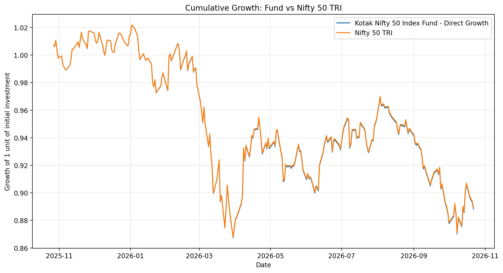
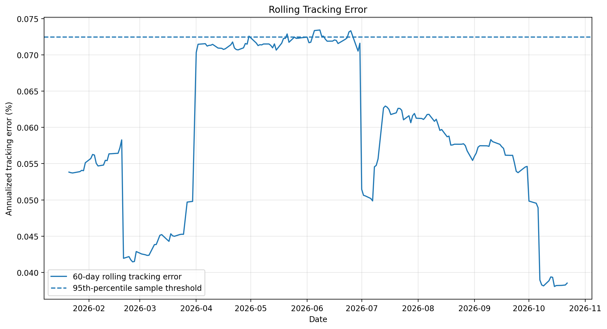
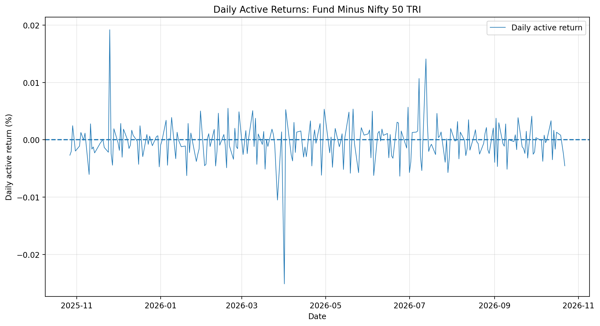

# Passive Fund Tracking Stress & Benchmark Drift Analysis

A quantitative research project that evaluates how closely an index mutual fund tracks its benchmark, measures benchmark-relative performance, and identifies periods of elevated tracking-error variability.

The project uses Python to build a reproducible data-analysis pipeline, validate source data, calculate performance and risk metrics, detect elevated tracking-error episodes, generate visualizations, and export results to Excel.

> **Research status:** Preliminary empirical analysis. Findings describe the supplied data and implemented methodology; they do not establish the causes of tracking deviations or constitute investment advice.

---

## Table of Contents

- [1. Project Overview](#1-project-overview)
- [2. Research Questions](#2-research-questions)
- [3. Fund and Benchmark](#3-fund-and-benchmark)
- [4. Data and Observation Period](#4-data-and-observation-period)
- [5. Methodology](#5-methodology)
- [6. Preliminary Results](#6-preliminary-results)
- [7. Visual Analysis](#7-visual-analysis)
- [8. Data Validation](#8-data-validation)
- [9. Project Architecture](#9-project-architecture)
- [10. Technology Stack](#10-technology-stack)
- [11. Installation and Setup](#11-installation-and-setup)
- [12. Running the Analysis](#12-running-the-analysis)
- [13. Output Files](#13-output-files)
- [14. Interpretation and Limitations](#14-interpretation-and-limitations)
- [15. Future Improvements](#15-future-improvements)
- [16. Reproducibility and Data Usage](#16-reproducibility-and-data-usage)

---

## 1. Project Overview

Index funds seek to replicate the performance of a specified market index. However, the fund's return may differ from the benchmark's return on individual days and over longer periods.

This project develops a quantitative framework to study those differences.

The analysis compares the daily Net Asset Value (NAV) of **Kotak Nifty 50 Index Fund — Direct Plan — Growth** with the **NIFTY 50 Total Returns Index (TRI)**.

It focuses on three related dimensions:

1. **Benchmark-relative performance:** How much did the fund return compared with the benchmark?
2. **Tracking-error variability:** How much did daily active returns fluctuate?
3. **Elevated tracking-error periods:** When did rolling tracking error exceed a retrospective statistical threshold?

The project emphasizes transparent calculations, data validation, reproducibility, and cautious interpretation.

### Key deliverables

- Automated data loading and date alignment
- Daily fund and benchmark return calculations
- Active-return and cumulative-performance analysis
- Annualized tracking error and information ratio
- 60-observation rolling tracking error
- Retrospective elevated-error episode detection
- Three PNG visualizations
- Excel workbook with metrics, aligned data, and stress episodes
- Automated unit tests
- Data validation report
- Research note and project documentation

## 2. Research Questions

The project investigates the following questions:

**RQ1 — Relative performance:** How did the fund's cumulative return compare with the benchmark's cumulative return over the observation period?

**RQ2 — Tracking variability:** What was the annualized standard deviation of the fund's daily active returns?

**RQ3 — Elevated-error periods:** Which observations exceeded the 95th percentile of the observed rolling tracking-error distribution?

**RQ4 — Persistence:** Did elevated observations occur consecutively, forming identifiable episodes?

These questions are descriptive. Detecting an elevated tracking-error period does not, by itself, explain why it occurred.

## 3. Fund and Benchmark

| Attribute | Specification |
|---|---|
| Fund | Kotak Nifty 50 Index Fund |
| Plan | Direct Plan |
| Option | Growth |
| Scheme code | 148978 |
| ISIN | INF174KA1HA7 |
| Benchmark | NIFTY 50 Total Returns Index (TRI) |
| Fund data | AMFI NAV files |
| Analysis language | Python |

The intended benchmark is the Total Returns Index rather than the ordinary price index. A total-return benchmark incorporates the index's specified treatment of dividends, making it more suitable for comparison with a mutual fund's NAV total-return experience.

The exact benchmark series and its source definition should be verified against the original official download before the results are used in formal research or an interview presentation.

## 4. Data and Observation Period

**Analysis period:** 24 October 2025 – 22 October 2026.

The input data consists of multiple AMFI NAV text files and a historical NIFTY 50 TRI CSV file.

The current data-processing run reports:

| Data stage | Observations |
|---|---:|
| Filtered fund NAV observations | 260 |
| Benchmark TRI observations | 247 |
| Common-date aligned observations | 245 |
| Valid daily return observations | 244 |

The NAV data begins before the analysis window so that the first aligned observation can establish a starting level. The return series begins one observation later because a daily return requires both a current and a preceding level.

The benchmark file contains an observation dated 23 October 2026, while the aligned analysis ends on 22 October 2026. The extra benchmark observation is excluded from the common-date analysis.

### Data processing

1. Read all NAV text files.
2. Filter observations to the target scheme code or ISIN.
3. Parse dates and convert NAV values to numeric form.
4. Remove invalid or non-positive NAV observations.
5. Sort observations chronologically and check duplicate dates.
6. Read the selected Total Returns Index series.
7. Align fund and benchmark levels by common date.
8. Calculate daily returns and active returns.
9. Save the aligned dataset for subsequent analysis.

## 5. Methodology

### 5.1 Daily returns

For either the fund or benchmark, the daily simple return is:

$$
r_t = \frac{P_t}{P_{t-1}} - 1
$$

where $P_t$ represents the NAV or TRI level on date $t$.

### 5.2 Daily active return

Daily active return measures the fund's return relative to its benchmark:

$$
a_t = r_{f,t} - r_{b,t}
$$

where:

- $r_{f,t}$ is the fund's daily return.
- $r_{b,t}$ is the benchmark's daily return.
- $a_t$ is the daily active return.

A negative active return means the fund underperformed the benchmark on that observation; a positive active return means it outperformed.

### 5.3 Cumulative return

Cumulative return compounds daily returns over the selected period:

$$
R_{\mathrm{cum}} = \prod_{t=1}^{T}(1+r_t)-1
$$

The cumulative return gap is:

$$
G = R_{f,\mathrm{cum}} - R_{b,\mathrm{cum}}
$$

The gap is reported in percentage points when both cumulative returns are expressed as percentages.

This absolute difference is distinct from the relative wealth gap, which compares the fund's and benchmark's ending wealth after accounting for their respective growth factors.

### 5.4 Annualized tracking error

Tracking error measures the variability of active returns. In this project, it is calculated using the sample standard deviation of daily active returns and a 252-trading-day annualization convention:

$$
TE_{\mathrm{ann}} = s(a_t)\sqrt{252}
$$

where $s(a_t)$ is the sample standard deviation of daily active returns.

Tracking error is not the same as cumulative underperformance. A fund can have a small cumulative return gap and still experience varying daily active returns.

### 5.5 Information ratio

The implemented information ratio is:

$$
IR = \frac{252\bar{a}}{TE_{\mathrm{ann}}}
$$

where $\bar{a}$ is mean daily active return.

This convention annualizes mean daily active return arithmetically and divides it by annualized tracking error. The ratio should be interpreted in the context of the selected period and methodology.

### 5.6 Rolling tracking error

The project calculates tracking error over a rolling window of 60 aligned daily return observations:

$$
TE_{t,60} = s(a_{t-59},\ldots,a_t)\sqrt{252}
$$

A rolling value is available only when the full 60-observation window is populated.

The rolling series helps reveal changes in the variability of active returns that a single full-period tracking-error estimate may conceal.

### 5.7 Elevated-error threshold and episodes

The project calculates the 95th percentile of the available rolling tracking-error observations and flags observations strictly above that threshold.

Consecutive flagged observations are grouped into episodes.

This is a **retrospective, sample-dependent threshold**. It is not a regulatory limit, a forecast, or a universal definition of a tracking failure.

## 6. Preliminary Results

The current pipeline produced the following preliminary results.

| Metric | Result |
|---|---:|
| Fund cumulative return | -11.1752% |
| Benchmark cumulative return | -11.0916% |
| Cumulative return gap | -0.0836 percentage points |
| Annualized tracking error | 0.057268% |
| Information ratio | -1.729851 |
| Rolling-window length | 60 observations |
| Elevated-error threshold | 95th percentile |
| Threshold value | 0.072445% |
| Elevated rolling observations | 10 |
| Detected elevated-error episodes | 5 |

### Preliminary interpretation

The fund's cumulative return was approximately 0.0836 percentage points below the benchmark's cumulative return over the observed period.

The negative information ratio indicates negative average active return under the implemented annualization convention, relative to the estimated tracking-error variability.

Ten rolling observations exceeded the retrospective 95th-percentile threshold. These observations were grouped into five episodes, including both isolated observations and short consecutive runs.

The results describe the data and calculations. They do not establish whether the observed deviations were economically material or identify a particular operational cause.

**Important data-quality consideration:** The reported annualized tracking error is small. NAV precision, benchmark selection, data provenance, and return alignment should be reviewed before drawing strong conclusions from this estimate.

## 7. Visual Analysis

The analysis generates three figures in `reports/figures/`.

### 7.1 Cumulative performance

This chart compares cumulative growth from the aligned daily return series for the fund and benchmark.

It is useful for examining the evolution of relative performance over the study period.



**File:** `reports/figures/cumulative_performance.png`

### 7.2 Rolling tracking error

This chart shows the annualized rolling tracking error calculated over 60 daily return observations. Where available, the chart also displays the retrospective 95th-percentile threshold.

It helps identify periods when active-return variability was relatively high compared with the rest of the sample.



**File:** `reports/figures/rolling_tracking_error.png`

### 7.3 Daily active returns

This chart shows the daily difference between fund returns and benchmark returns.

It highlights individual observations where the fund's daily return differed from the benchmark's return.



**File:** `reports/figures/daily_active_returns.png`

> **Note:** The charts are generated by the Python pipeline. They should be regenerated after any changes to the input data, methodology, or code.

## 8. Data Validation

The validation module compares the processed dataset with the source files and checks whether the calculations reconcile.

The current validation run reported:

| Validation check | Result |
|---|---|
| Missing dates in filtered NAV series | 0 |
| Missing values in filtered NAV series | 0 |
| Duplicate NAV dates | 0 |
| Missing dates in benchmark series | 0 |
| Missing benchmark values | 0 |
| Duplicate benchmark dates | 0 |
| Duplicate aligned dates | 0 |
| NAV level mismatches against source | 0 |
| TRI level mismatches against source | 0 |
| Fund return mismatches | 0 |
| Benchmark return mismatches | 0 |
| Fund cumulative-return reconciliation | PASS |
| Benchmark cumulative-return reconciliation | PASS |

The compounded daily returns reconciled with the first-to-last level returns for both series.

These checks establish computational consistency with the supplied source files. They do not independently establish that the files are complete, authoritative, or the correct official benchmark series.

Automated unit tests are also included to check metric behavior on controlled synthetic datasets.

## 9. Project Architecture

The project is organized into separate modules for loading data, calculating metrics, detecting elevated-error episodes, generating charts, creating the Excel workbook, and validating results.

```text
benchmark-drift-analysis/
│
├── data/
│   ├── raw/
│   │   ├── nav/
│   │   └── benchmark/
│   └── processed/
│
├── excel/
│   └── benchmark_drift_analysis.xlsx
│
├── src/
│   ├── data_loader.py
│   ├── metrics.py
│   ├── stress_analysis.py
│   ├── charts.py
│   ├── excel_report.py
│   └── validate_data.py
│
├── tests/
│   └── test_metrics.py
│
├── reports/
│   ├── figures/
│   │   ├── cumulative_performance.png
│   │   ├── rolling_tracking_error.png
│   │   └── daily_active_returns.png
│   ├── project_summary.md
│   └── research_note.md
│
├── main.py
├── requirements.txt
├── .gitignore
└── README.md
```

*The tree represents the intended project layout. Generated files may be absent until the corresponding commands have been run.*

## 10. Technology Stack

| Technology | Role |
|---|---|
| Python | Analysis pipeline |
| pandas | Data loading, filtering, alignment, and time-series calculations |
| NumPy | Numerical calculations |
| Matplotlib | Research visualizations |
| openpyxl | Excel workbook creation and formatting |
| pytest | Automated unit tests |
| VS Code | Development environment |
| Git and GitHub | Version control and project sharing |

## 11. Installation and Setup

### Prerequisites

- Python 3.10 or a compatible newer version
- Visual Studio Code or another Python development environment
- Git (optional for local analysis; required for GitHub version control)

### Clone the repository

If the project is already open locally, skip this step.

```bash
git clone <YOUR_REPOSITORY_URL>
cd benchmark-drift-analysis
```

Replace `<YOUR_REPOSITORY_URL>` with the actual repository URL after creating the GitHub repository.

### Create a virtual environment

Windows PowerShell:

```powershell
python -m venv .venv
.\.venv\Scripts\Activate.ps1
```

If PowerShell blocks activation, use the Python executable inside `.venv` directly or follow the Python environment guidance appropriate to your system.

### Install dependencies

```powershell
python -m pip install --upgrade pip
pip install -r requirements.txt
```

The requirements file contains the project's core dependencies:

```text
pandas
numpy
matplotlib
openpyxl
pytest
```

### Prepare the input data

Place the relevant AMFI NAV text files in:

```text
data/raw/nav/
```

Place the selected NIFTY 50 TRI CSV in:

```text
data/raw/benchmark/
```

The data loader expects the NAV files to contain the relevant AMFI fields, including scheme identification, NAV, and date. The benchmark CSV must include a date column and the selected `Total Returns Index` column.

Use the intended fund scheme and verify the benchmark definition before running the analysis. Keep a record of the original source, download date, and any transformations performed.

## 12. Running the Analysis

Run these commands from the project root.

### Run the full pipeline

```powershell
python main.py
```

The pipeline rebuilds aligned data, recalculates performance metrics, identifies elevated-error episodes, and generates charts.

### Generate the Excel workbook

```powershell
python -m src.excel_report
```

Expected output:

```text
excel/benchmark_drift_analysis.xlsx
```

### Validate the source and processed data

```powershell
python -m src.validate_data
```

Expected output:

```text
data/processed/data_validation_report.txt
```

### Run automated tests

```powershell
python -m pytest -v
```

The tests use controlled datasets to verify metric behavior and expected error handling. A passing test suite does not independently validate the external data source.

### Run individual modules

```powershell
python -m src.data_loader
python -m src.metrics
python -m src.stress_analysis
python -m src.charts
```

For reproducible results, run the pipeline from the project root with the intended input files in place.

## 13. Output Files

### Processed data

| File | Description |
|---|---|
| `data/processed/aligned_daily_data.csv` | Aligned NAV and TRI levels, daily returns, active returns, and rolling tracking error |
| `data/processed/summary_metrics.csv` | Full-period performance and tracking metrics |
| `data/processed/stress_flags.csv` | Rolling observations and elevated-error flags |
| `data/processed/stress_episodes.csv` | Start date, end date, duration, and error statistics for each episode |
| `data/processed/data_validation_report.txt` | Validation results and reconciliation checks |

### Research outputs

| File | Description |
|---|---|
| `excel/benchmark_drift_analysis.xlsx` | Workbook containing a dashboard, aligned data, stress episodes, and methodology |
| `reports/figures/cumulative_performance.png` | Cumulative performance comparison |
| `reports/figures/rolling_tracking_error.png` | Rolling tracking error and threshold |
| `reports/figures/daily_active_returns.png` | Daily active-return visualization |
| `reports/research_note.md` | Written research note |
| `reports/project_summary.md` | Concise project summary |

## 14. Interpretation and Limitations

The results should be interpreted within the limits of the data and methods used.

1. **Source-data provenance:** The source-level validation checks confirm agreement with the downloaded files, not independent authenticity or completeness.
2. **Benchmark definition:** The selected benchmark must be verified as the intended NIFTY 50 TRI series. A price index is not interchangeable with a total-return index.
3. **NAV precision:** Rounded NAV values may affect calculated daily returns and tracking error. This is especially important when the estimated tracking error is small.
4. **Observation period:** Findings describe one particular period and may not generalize to other market conditions.
5. **Retrospective threshold:** The 95th-percentile threshold is determined by the sample itself. It is not a predictive signal or an official limit.
6. **Causality:** The project does not establish that fund expenses, cash holdings, trading costs, corporate actions, or rebalancing decisions caused the observed deviations.
7. **Annualization:** Tracking error and information ratio use the stated 252-trading-day convention.
8. **Rolling-window choice:** A 60-observation window is a modeling choice; other windows could produce different episodes.
9. **Economic materiality:** Statistical flags alone do not show that an observed deviation was economically significant.
10. **Investment use:** This project is for quantitative research and educational analysis, not personalized investment advice.

## 15. Future Improvements

Potential extensions include:

- Verify benchmark provenance and the precise TRI series definition against the original official source.
- Compare results using higher-precision or independently verified data where available.
- Perform sensitivity analysis using 20-, 60-, and 120-observation rolling windows.
- Compare multiple funds tracking the same benchmark.
- Examine flagged dates using independently verified market and fund disclosures.
- Add confidence intervals or bootstrap analysis for tracking-error estimates.
- Test alternative threshold definitions and report their sensitivity.
- Add continuous integration to run unit tests on every code change.
- Improve automated data-quality checks and generate a machine-readable validation summary.
- Add a reproducible environment lock file and data-source metadata.

Any extension should distinguish descriptive results from causal explanations and should document assumptions explicitly.

## 16. Reproducibility and Data Usage

For a reproducible analysis:

1. Record the data provider, source page, download date, and benchmark series name.
2. Preserve original input files separately from processed outputs.
3. Document all transformations and analysis assumptions.
4. Run the validation module before interpreting the results.
5. Run the unit tests after code changes.
6. Regenerate the charts and Excel workbook after changing inputs or calculations.

Before publishing the repository, review the source providers' terms and any applicable redistribution restrictions. If raw data cannot be redistributed, exclude it from GitHub and provide instructions for obtaining it independently.

The project is intended to demonstrate quantitative data engineering, time-series analysis, statistical risk measurement, validation, visualization, and reproducible research practices.

---

**Disclaimer:** This project is an independent analytical exercise. It is not affiliated with or endorsed by Kotak Mahindra Asset Management, AMFI, or NSE Indices. Fund and index names are used to identify the data series being studied. The analysis is not investment advice.